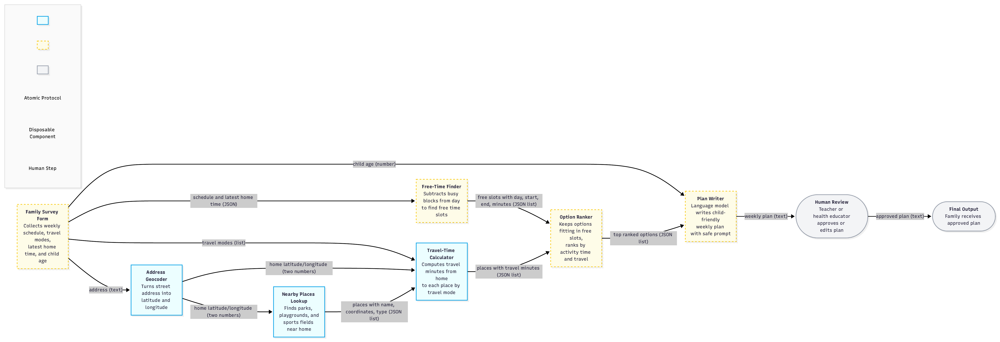

# Family Schedules

 [](https://github.com/CorteJ98/FamilySchedules-/actions/workflows/tests.yml)

This repository holds unit tests for the **Address Geocoder** atomic protocol used in my final project, *Fitting Physical Activities into Family Schedules*. The geocoder turns a family's U.S. street address into latitude and longitude, which later steps use to find nearby parks and playgrounds and estimate travel times. The protocol is the public [OpenStreetMap Nominatim Search API](https://nominatim.org/release-docs/latest/api/Search/) (version 5.3.3 manual), which is the citable source. The tests call it exactly the way the workflow's glue code does.

## Wire diagram

The Address Geocoder is the first step after the Family Survey Form: it turns the family's street address into latitude and longitude, which feed the Nearby Places Lookup and the Travel-Time Calculator.



## Contract

| | Type | Description |
|---|---|---|
| **Input** | `str` | One U.S. street address, e.g. `"55 W 125th St, New York, NY 10027"` |
| **Output** | `list` of `dict` (JSON, HTTP 200) | Top match with `lat` and `lon` as decimal strings; an empty list `[]` means no match |

Request configuration: `GET https://nominatim.openstreetmap.org/search` with `q=<address>`, `format=jsonv2`, `limit=1`, `countrycodes=us`, `addressdetails=1`, an identifying `User-Agent`, a 20-second timeout, and spacing between requests to respect the usage policy. No API key is needed.

## Tested versions

- requests 2.32.5
- pytest 8.4.2

## Setup

```bash
python3 -m venv .venv
source .venv/bin/activate        # Windows: .venv\Scripts\activate
pip install -r requirements.txt
```

## Running the tests

```bash
pytest -v
```

Expected result: **14 passed**. The tests wait 15 seconds between requests, so the run takes a few minutes.

## What the tests cover

- **Typical inputs:** well-known addresses (White House, Empire State Building, Ferry Building) return coordinates within 0.01 degrees of reference values, valid coordinate ranges, and a U.S. country code.
- **Edge cases:** address without a ZIP code, ambiguous street names respect `limit=1`, non-U.S. addresses are excluded, a very long query does not cause a server error, and an invented address returns an empty list.
- **Invalid inputs:** empty, whitespace-only, and `None` queries return an HTTP 400 error or an empty list, never nonsense.

## Known limitations

- The tests call the live public Nominatim server, which is shared by many users. They can fail from rate limiting or temporary outages, not just from real bugs.
- Reference coordinates are approximate.

  ## Running the Full Family Schedules Workflow

The full workflow can be run with one command from the repository's main directory:

```bash
python main.py
```

The workflow uses the synthetic family information stored in `family_survey.json`. It follows the nine components shown in the wire diagram:

1. **Family Survey Form:** Reads the family's schedule, address, child's age, and transportation preferences.
2. **Address Geocoder:** Uses OpenStreetMap Nominatim to convert the street address into latitude and longitude.
3. **Nearby Places Lookup:** Searches OpenStreetMap for nearby parks and playgrounds. If the search is unavailable or returns no usable places, backup sample locations are used.
4. **Free-Time Finder:** Identifies available time by subtracting busy blocks from the family's schedule.
5. **Travel-Time Calculator:** Estimates travel times using the family's transportation preferences.
6. **Option Ranker:** Ranks activity options based on available time and travel time.
7. **Plan Writer:** Creates a weekly activity plan.
8. **Human Review:** Displays the proposed plan and asks the user to approve or reject it.
9. **Final Output:** Saves the approved plan to `output/approved_plan.txt`.

An internet connection is required for address geocoding and nearby-place searches.

### Approving the Plan

After the proposed plan is displayed, the user can type `y` to approve it or `n` to reject it. Only approved plans are saved.

For testing purposes, the workflow can also be run without the interactive approval question:

```bash
python main.py --auto-approve
```

This option automatically approves the plan and is intended for testing and demonstration.

### Running with a Different Input or Output File

The workflow also supports custom survey and output file paths:

```bash
python main.py --survey path/to/survey.json --out path/to/plan.txt
```

### Running Unit Tests

The automated unit tests can be run locally using:

```bash
python -m pytest -v
```

The GitHub Actions workflow also runs tests automatically when changes are pushed to the repository or a pull request is opened.
